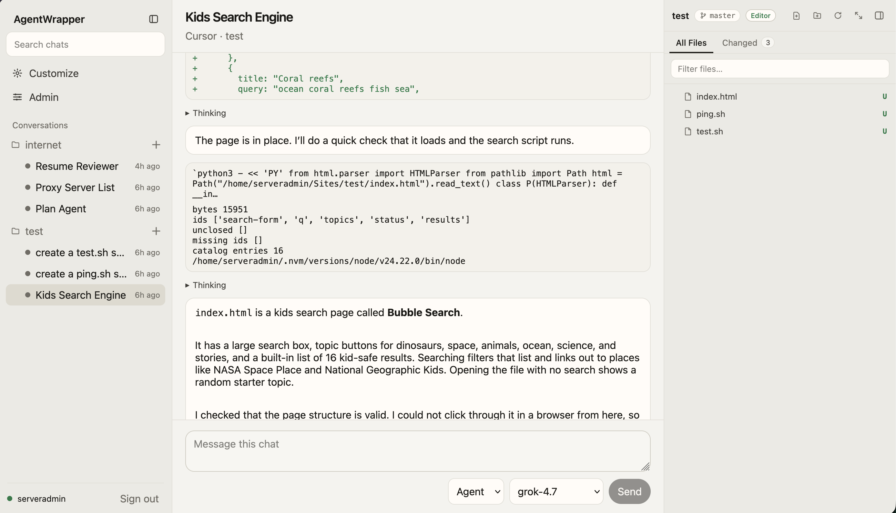
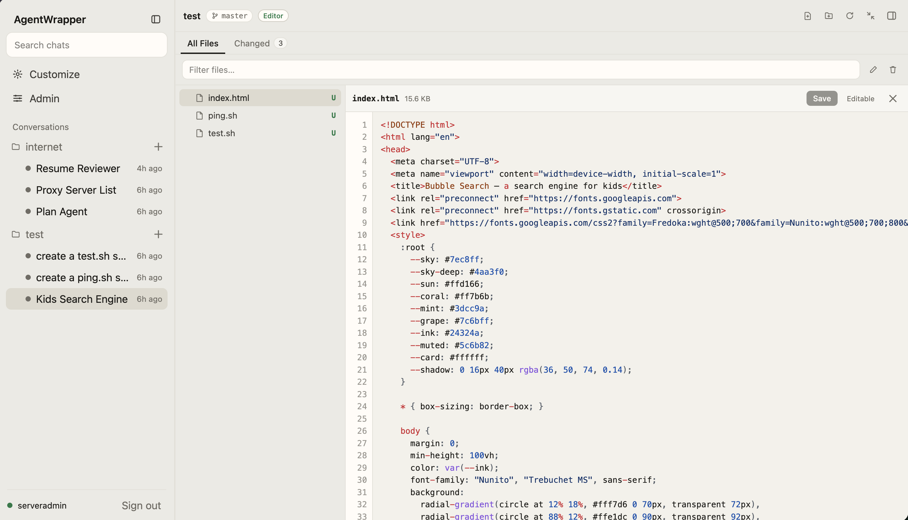
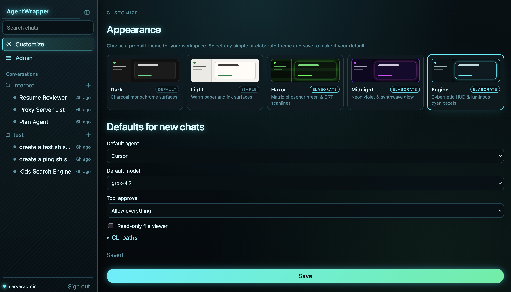
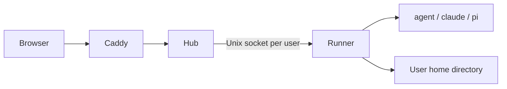

# Engineroom

Engineroom is a self-hosted web UI for running AI coding agents on a Linux server. People sign in with their Linux account. Each person gets a runner that executes chats, repositories, and a terminal inside that account's home directory. Built-in agents are Cursor (`agent`), Claude (`claude`), and Pi (`pi`). Administrators can also register custom agent commands.

This is a multi-user server, not a desktop app. A checkout of this repository may be named `agent-wrapper`; the product, systemd units, and binaries are Engineroom.

## Screenshots

Chat with an agent, with the repository file list open:



File editor for a file in that repository:



Per-user settings for theme, default agent, model, and tool approval:



## Features

- Web chat with streaming replies, modes, and models reported by each agent
- Workspace picker, repository catalog, and git clone into the user's home
- File manager and editor for granted repositories (administrator can turn these off)
- Optional raw terminal in the user's session
- Per-user settings: theme, default agent and model, tool approval, CLI paths
- Admin pages for server overview, agents, repository catalog, and Linux accounts

## Requirements

Production needs Linux with systemd, Node.js 24 or newer, and a C compiler toolchain (`python3`, `make`, `g++`) because `node-pty` compiles during install. First-time setup on Debian or Ubuntu is [`setup.sh`](setup.sh).

## Quick start

From a checkout, as root:

```bash
sudo ./setup.sh
```

The script installs Node 24 if needed, builds the web UI, installs the hub and runner, and starts `engineroom-hub.service` and Caddy. Open the site and sign in with a Linux username and password. Chats stay in that home directory.

The account that ran the script (or `ENGINEROOM_ADMIN`, if set) is the administrator. That account can turn agents on or off and add or revoke people from the Admin page. Each person still signs in once to the CLIs (`agent`, `claude`, `pi`) from their own account so those credentials stay in their home.

For HTTPS, set the public hostname and run setup again:

```bash
sudo ENGINEROOM_HOST=chat.example.com ./setup.sh
```

Check the hub with `systemctl status engineroom-hub`.

## Documentation

| Topic | Document |
| --- | --- |
| Install, update, users, Caddy | [docs/installation.md](docs/installation.md) |
| Scripts, tests, local hub and UI | [docs/development.md](docs/development.md) |
| Hub, runner, and security model | [docs/architecture.md](docs/architecture.md) |
| `ENGINEROOM_*` variables and files | [docs/configuration.md](docs/configuration.md) |

## Layout

| Piece | Path | Role |
| --- | --- | --- |
| Hub | [`apps/hub`](apps/hub) | HTTP API, WebSocket, sessions, admin; talks to runners over Unix sockets |
| Runner | [`apps/runner`](apps/runner) | Per-user agent execution, terminal, files, and chat storage under `$HOME` |
| Web | [`apps/web`](apps/web) | React UI. The Vite dev server proxies `/api` to `127.0.0.1:8787` |
| Protocol | [`packages/protocol`](packages/protocol) | Shared types and the hub–runner wire format |
| Peercred | [`packages/peercred`](packages/peercred) | Checks that a socket peer is the hub user |
| Deploy | [`deploy`](deploy) | systemd units, PAM helpers, Caddy example, install script |


