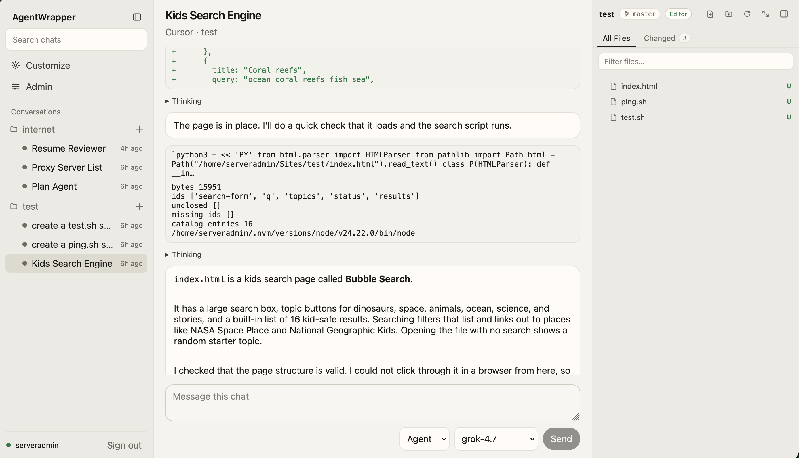
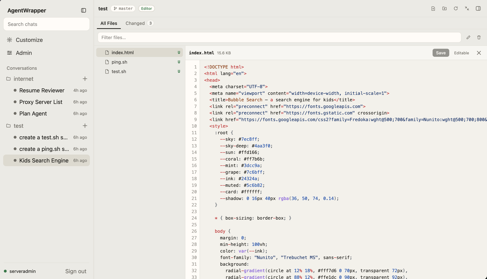
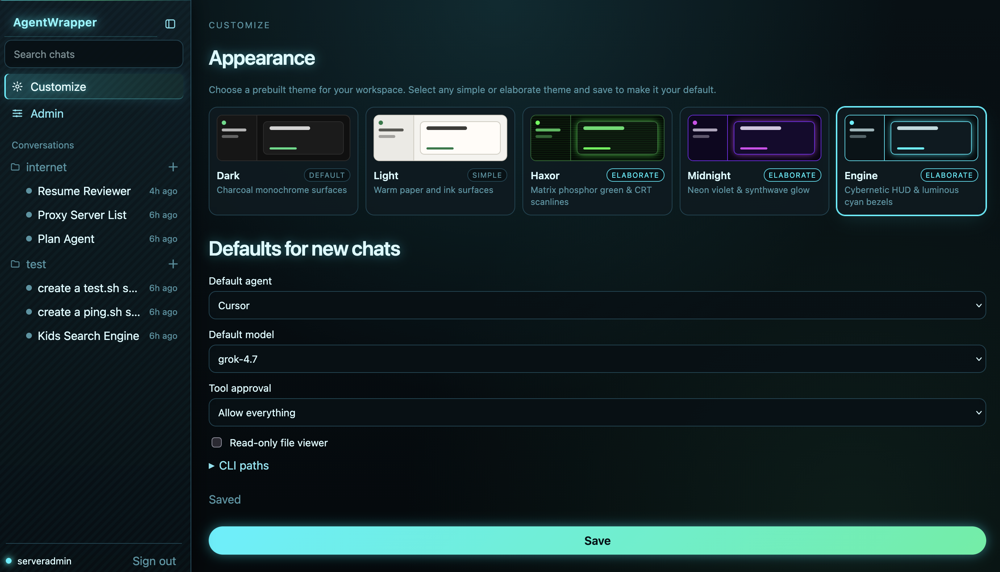
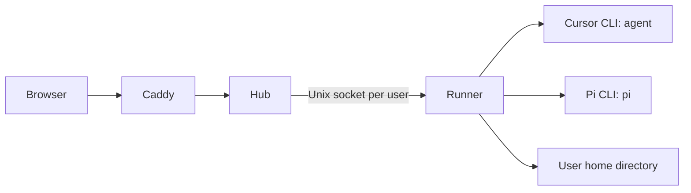

# Engineroom

Engineroom is a self-hosted web UI for two coding CLIs: the Cursor CLI (`agent`) and [Pi](https://pi.dev) (`pi`). It does not replace those harnesses. A chat and the optional terminal run the installed command as the signed-in Linux user, in that person's home directory. The CLI edits the project files itself.

People sign in with their Linux username and password. One hub serves the site. Each person gets a runner that stores chats and starts the CLIs, so each CLI's own sign-in and config stay in that home directory.

- **Cursor** is driven with `agent acp`. When that adapter is not available, the runner falls back to `agent -p --output-format stream-json`. Config is `~/.cursor/cli-config.json`. An existing Cursor CLI session can be imported into a chat. Engineroom does not install `agent`; it has to be on that account's `PATH`.
- **Pi** is driven with `pi --mode json`. Config is `~/.pi/agent/settings.json`. Set up Pi on the site installs `@earendil-works/pi-coding-agent` under `~/.local` via [`agents/setup_pi.sh`](agents/setup_pi.sh).

An administrator chooses which of those two are offered, which modes and models each person may use, and can write shared defaults into each person's CLI config. Extra commands that speak ACP can be registered the same way.

This is a multi-user server, not a desktop app. The product, systemd units, and binaries are Engineroom.

## Screenshots

Chat with an agent, with the repository file list open:



File editor for a file in that repository:



Per-user settings for theme, default agent, model, and tool approval:



## What the site adds

The CLIs stay the agents. The site is the shared place to use them:

- Streaming chat, with the modes and models that CLI reports
- Attachments, queued follow-ups, and tool approval
- Projects under the home directory (default `Sites`): clone, branches, pull, push, and commits
- File list and editor for a granted project
- Optional terminal on the same CLI session (`agent --resume`, or `pi --session-id`)
- Per-account theme, default CLI and model, and the Cursor shell allow-list
- Admin for Linux accounts, which CLIs they may use, repository grants, the server name, and Wi-Fi

## Requirements

Production needs Linux with systemd, Node.js 24 or newer, and a C compiler toolchain (`python3`, `make`, `g++`) because `node-pty` compiles during install. First-time setup on Debian or Ubuntu is [`setup.sh`](setup.sh).

Each account that uses Cursor needs `agent` installed already. Pi can be installed after sign-in from the site, or by running `agents/setup_pi.sh` as that user. Each person still signs in once to `agent` and `pi` from their own account.

## Quick start

From a checkout, as root:

```bash
sudo ./setup.sh
```

The script installs Node 24 if needed, builds the web UI, installs the hub and runner, and starts `engineroom-hub.service` and Caddy. Open the site and sign in with a Linux username and password. Chats stay in that home directory.

The account that ran the script (or `ENGINEROOM_ADMIN`, if set) is the administrator. That account can turn Cursor or Pi on or off and add or revoke people from the Admin page.

For HTTPS, set the public hostname and run setup again:

```bash
sudo ENGINEROOM_HOST=chat.example.com ./setup.sh
```

Check the hub with `systemctl status engineroom-hub`.

## Documentation

| Topic | Document |
| --- | --- |
| Using the site | [docs/guide/README.md](docs/guide/README.md) |
| Install, update, users, Caddy | [docs/installation.md](docs/installation.md) |
| Scripts, tests, local hub and UI | [docs/development.md](docs/development.md) |
| Hub, runner, and security model | [docs/architecture.md](docs/architecture.md) |
| `ENGINEROOM_*` variables and files | [docs/configuration.md](docs/configuration.md) |
| Themes, docs, and agents from packages | [docs/extensions.md](docs/extensions.md) |

## Layout

| Piece | Path | Role |
| --- | --- | --- |
| Hub | [`apps/hub`](apps/hub) | HTTP API, WebSocket, sessions, admin; talks to runners over Unix sockets |
| Runner | [`apps/runner`](apps/runner) | Launches `agent` and `pi` for one user, plus the terminal, files, and chat storage under `$HOME` |
| Web | [`apps/web`](apps/web) | React UI. The Vite dev server proxies `/api` to `127.0.0.1:8787` |
| Protocol | [`packages/protocol`](packages/protocol) | Shared types and the hub–runner wire format |
| Peercred | [`packages/peercred`](packages/peercred) | Checks that a socket peer is the hub user |
| Deploy | [`deploy`](deploy) | systemd units, PAM helpers, Caddy example, install script |


