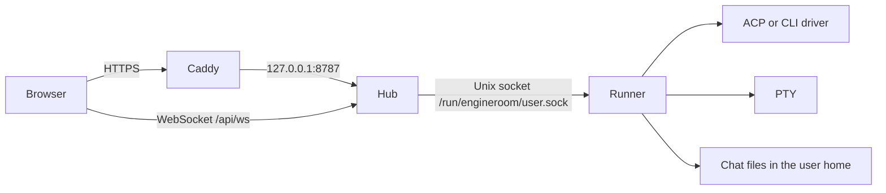

# Architecture

Engineroom splits a multi-user web app from the processes that run agent CLIs. The hub is one shared service. Each person who signs in gets their own runner, as their Linux user, with their home directory as the working directory.

## Hub

[`apps/hub`](../apps/hub) is an HTTP server. In production it also serves the built UI from `ENGINEROOM_WEB_DIST`. [`apps/hub/src/server.ts`](../apps/hub/src/server.ts) handles:

- `POST /api/login` and `POST /api/logout`, and `GET /api/me`
- `GET /api/health` for install and update checks
- Admin and user JSON routes under `/api/`
- WebSocket upgrades on `/api/ws` for chat events and terminal frames
- Static files when `webDist` is set; otherwise non-API paths return 404

Login looks the account up with `getent` and checks the password with the PAM helper. A session is an HMAC cookie, `engineroom_session`, valid for 12 hours ([`apps/hub/src/session.ts`](../apps/hub/src/session.ts)). The signing key is created on first start and stored in `ENGINEROOM_SESSION_SECRET_FILE`.

Requests that need the user's agents, chats, files, or terminal are turned into one JSON line and written to that user's runner socket. [`apps/hub/src/runner-client.ts`](../apps/hub/src/runner-client.ts) connects to `$ENGINEROOM_SOCKET_DIR/<username>.sock`. If the socket is not there, the hub runs `sudo -n engineroom-ctl start <username>`, which starts `engineroom-runner@<username>.socket`.

Shared admin state (which agents are offered, the repository catalog, branding) lives in the JSON files under `/var/lib/engineroom`, not in a database. Per-user chat state stays in the runner.

## Runner

[`apps/runner`](../apps/runner) listens on a Unix socket only. [`apps/runner/src/server.ts`](../apps/runner/src/server.ts) dispatches a request protocol defined in [`packages/protocol`](../packages/protocol). One connection is one request and a JSON response, except `subscribe`, which stays open and pushes chat events and PTY output.

The runner owns:

- Chat transcripts and settings under the user's home
- The ACP session manager for Cursor, Claude, and custom agents, with CLI fallbacks where ACP is not available
- A PTY for the raw terminal (`node-pty`)
- Repository detection, git clone, and the file manager (list, read, write, rename)

The hub never runs `agent`, `claude`, or `pi`. Those processes are children of the runner, so they see the user's `HOME`, `PATH`, and SSH agent.

## Security model

- **Who may sign in.** The account must be in `engineroom-users`, have uid 500 or higher, and use a real shell. Password checking is delegated to `engineroom-pam-auth` (`/etc/pam.d/engineroom`).
- **Who may call a runner.** The hub checks that the socket file is owned by the signed-in uid and that the peer process is that uid, or uid 0 while systemd still holds the listener. The runner checks the reverse: the peer must be the runner's own uid or `ENGINEROOM_HUB_USER`. Both checks use `engineroom-peercred`.
- **No root.** `engineroom-hub` and `engineroom-runner` exit immediately when uid is 0.
- **Browser origin.** A WebSocket upgrade requires an `Origin` whose host matches `Host`. State-changing HTTP requests are rejected when `Origin` is set and does not match `Host`, or when `Sec-Fetch-Site` is something other than `same-origin` or `none`.
- **Admin.** Only the username in `ENGINEROOM_ADMIN` is treated as the administrator. Account create, revoke, password, and remove go through `engineroom-admin` (sudo), not through the hub process.
- **systemd hardening on the hub.** The unit sets `ProtectSystem=strict`, `ProtectHome=true`, and `PrivateTmp=true`, with writes limited to `/var/lib/engineroom`. The hub still reaches user homes only by asking the runner.

## systemd

| Unit | Role |
| --- | --- |
| [`engineroom-hub.service`](../deploy/systemd/engineroom-hub.service) | Hub as user `engineroom`, listening on `127.0.0.1:8787` |
| [`engineroom-runner@.socket`](../deploy/systemd/engineroom-runner@.socket) | Listens on `/run/engineroom/%i.sock`, owned by that user, group `engineroom`, mode `0660` |
| [`engineroom-runner@.service`](../deploy/systemd/engineroom-runner@.service) | Runner as `%i`, socket-activated, `UMask=0077` |

`engineroom-ctl start USER` starts the socket unit. `stop` stops both the service and the socket.

## Related

- Install and Caddy: [installation.md](installation.md)
- Environment variables: [configuration.md](configuration.md)
