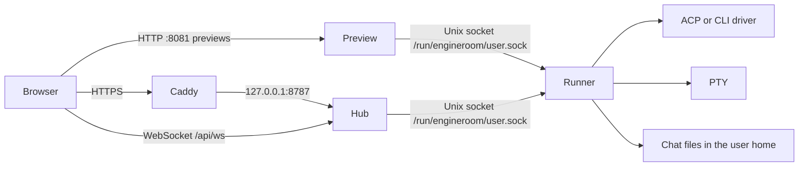

# Architecture

Engineroom splits a multi-user web app from the processes that run agent CLIs. The hub is one shared service. Each person who signs in gets their own runner, as their Linux user, with their home directory as the working directory.

## Hub

[`apps/hub`](../apps/hub) is an HTTP server. In production it also serves the built UI from `ENGINEROOM_WEB_DIST`. [`apps/hub/src/server.ts`](../apps/hub/src/server.ts) handles:

- `POST /api/login` and `POST /api/logout`, and `GET /api/me`
- `POST /api/password` for a person changing their own password, after the hub checks the current one with PAM (the administrator account is refused)
- `GET /api/health` for install and update checks
- Admin and user JSON routes under `/api/`
- WebSocket upgrades on `/api/ws` for chat events and terminal frames
- Static files when `webDist` is set; otherwise non-API paths return 404
- A redirect to the preview port for `/<username>/...`, when previews are on

`GET /<username>/...` and `GET /<username>/` on the app port are answered with a 302 to the same path on `ENGINEROOM_PREVIEW_LISTEN`, so an old bookmark keeps working. Nothing is read from the home for that redirect: it happens before any file is opened.

Login looks the account up with `getent` and checks the password with the PAM helper. A session is an HMAC cookie, `engineroom_session`. It lasts for the signed-in time chosen by the administrator: 12 hours unless changed, and at most 24 ([`apps/hub/src/session.ts`](../apps/hub/src/session.ts)). The clock starts at sign-in. The signing key is created on first start and stored in `ENGINEROOM_SESSION_SECRET_FILE`.

Requests that need the user's agents, chats, files, or terminal are turned into one JSON line and written to that user's runner socket. [`apps/hub/src/runner-client.ts`](../apps/hub/src/runner-client.ts) connects to `$ENGINEROOM_SOCKET_DIR/<username>.sock`. If the socket is not there, the hub runs `sudo -n engineroom-ctl start <username>`, which starts `engineroom-runner@<username>.socket`.

Shared admin state (which agents are offered, the repository catalog, branding) lives in the JSON files under `/var/lib/engineroom`, not in a database. Per-user chat state stays in the runner.

## Runner

[`apps/runner`](../apps/runner) listens on a Unix socket only. [`apps/runner/src/server.ts`](../apps/runner/src/server.ts) dispatches a request protocol defined in [`packages/protocol`](../packages/protocol). One connection is one request and a JSON response, except `subscribe`, which stays open and pushes chat events and PTY output.

The runner owns:

- Chat transcripts and settings under the user's home
- The ACP session manager for Cursor and custom agents, with CLI fallbacks where ACP is not available
- A PTY for the raw terminal (`node-pty`)
- Repository detection, git clone, and the file manager (list, read, write, rename)
- One Obscura process per account, with one page per chat. The runner holds the only debugging connection and sends pictures of that page to the browser. The agent drives the same page through a helper on the runner socket, so a second connection cannot open a different page.

The hub never runs `agent` or `pi`. Those processes are children of the runner, so they see the user's `HOME`, `PATH`, and SSH agent.

### Site previews

[`apps/hub/src/preview.ts`](../apps/hub/src/preview.ts) is a second HTTP server in the hub process, on `ENGINEROOM_PREVIEW_LISTEN` (default `0.0.0.0:8081`). It serves static files from `~/<repository directory>/<project>/` at `/<username>/<project>/<file>`.

The port is bound at startup, but whether it answers is the `sitePreviews` key in `/var/lib/engineroom/agents.json` (`loadSitePreviews` in [`apps/hub/src/agents.ts`](../apps/hub/src/agents.ts)), which is off when the file or the key is missing. The setting is read on every request through the `enabled` callback, so the Admin switch takes effect without a restart; while it is off every path gets a 404 before any account or file is looked up, and the app stops redirecting `/<user>/...` to the port. Reads go through the same runner socket as the file manager, so the hub still needs no access to a home directory, and the runner applies the same containment checks: no `..`, no dot segments, no symlink out of the folder, no server-side scripts. Only `GET` and `HEAD` are answered.

The preview server is a separate origin on purpose. The session cookie is not scoped to a port, so a page on `:8081` is same-site with the app and its fetches do carry `engineroom_session`. What stops it from acting on that cookie is the app's own origin check: a request whose `Origin` names `:8081` does not match the `Host` on `:8787`, so a mutation is refused, and a read gets no CORS headers to expose its result to the page.

## Security model

- **Who may sign in.** The account must be in `engineroom-users`, have uid 500 or higher, and use a real shell. Password checking is delegated to `engineroom-pam-auth` (`/etc/pam.d/engineroom`).
- **Who may call a runner.** The hub checks that the socket file is owned by the signed-in uid and that the peer process is that uid, or uid 0 while systemd still holds the listener. The runner checks the reverse: the peer must be the runner's own uid or `ENGINEROOM_HUB_USER`. Both checks use `engineroom-peercred`.
- **No root.** `engineroom-hub` and `engineroom-runner` exit immediately when uid is 0.
- **Browser origin.** A WebSocket upgrade requires an `Origin` whose host matches `Host`. State-changing HTTP requests are rejected when `Origin` is set and does not match `Host`, or when `Sec-Fetch-Site` is something other than `same-origin` or `none`.
- **Password.** A person changing their own password is authenticated twice: the current password through `engineroom-pam-auth`, and the new one written by `engineroom-admin passwd` (sudo). Attempts share the same per-address counter as sign-in. The administrator account is refused because `engineroom-admin` will not change it.
- **Admin.** Only the username in `ENGINEROOM_ADMIN` is treated as the administrator. Account create, revoke, password, and remove go through `engineroom-admin` (sudo). The network name and Wi-Fi go through `engineroom-network` (sudo). An update goes through `engineroom-update` (sudo) after the hub has checked the administrator's password. That helper starts `update.sh` in a transient unit so the hub restart does not stop the script.
- **systemd hardening on the hub.** The unit sets `ProtectSystem=strict`, `ProtectHome=true`, and `PrivateTmp=true`, with writes limited to `/var/lib/engineroom`. The hub still reaches user homes only by asking the runner.

## systemd

| Unit | Role |
| --- | --- |
| [`engineroom-hub.service`](../deploy/systemd/engineroom-hub.service) | Hub as user `engineroom`, listening on `127.0.0.1:8787`, and the site preview server on `0.0.0.0:8081` |
| [`engineroom-runner@.socket`](../deploy/systemd/engineroom-runner@.socket) | Listens on `/run/engineroom/%i.sock`, owned by that user, group `engineroom`, mode `0660` |
| [`engineroom-runner@.service`](../deploy/systemd/engineroom-runner@.service) | Runner as `%i`, socket-activated, `UMask=0077` |

`engineroom-ctl start USER` starts the socket unit. `stop` stops both the service and the socket.

## Related

- Install and Caddy: [installation.md](installation.md)
- Environment variables: [configuration.md](configuration.md)
